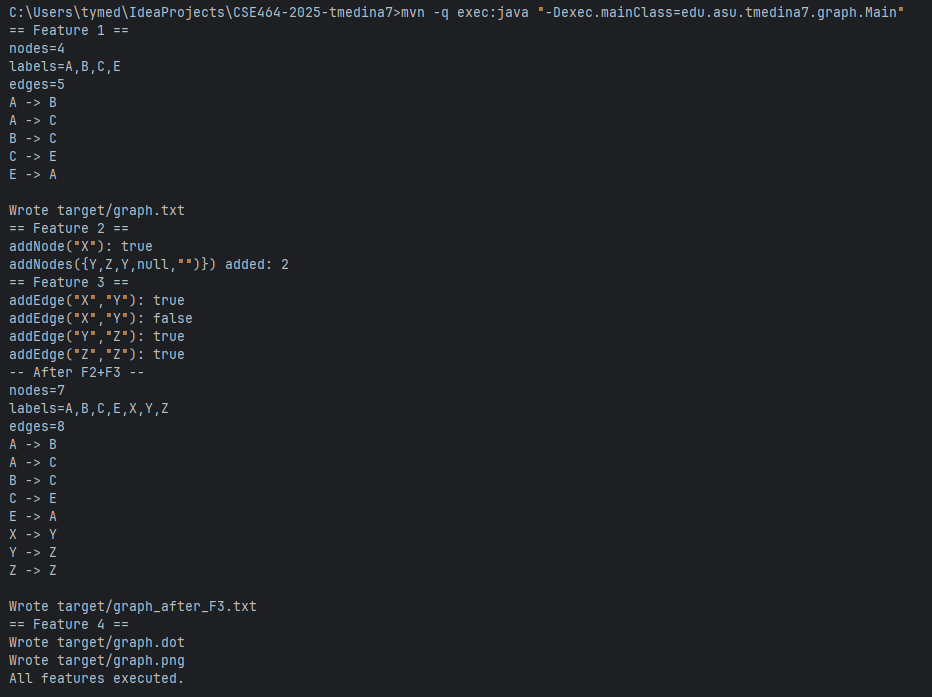
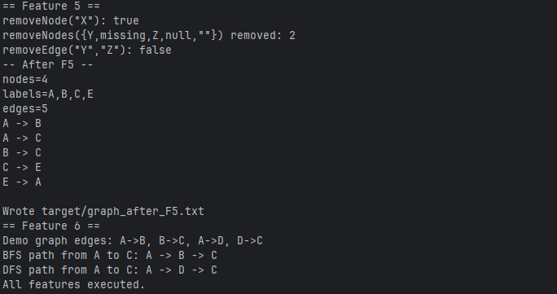

# CSE464 — Project Parts 1 & 2

## Prereqs

Java 17 • Maven 3.9+ • Graphviz on PATH (`dot -V`).

## Build

```bash
mvn clean package
```

## Run

```bash
mvn -q exec:java "-Dexec.mainClass=edu.asu.tmedina7.graph.Main"
```

Outputs in `target/`:

-   `graph.txt` (text summary)
-   `graph.dot` & `graph.png` (Feature 4)

## Features Implemented

1.  Parse DOT → stable summary → write file
2.  Add nodes (skip null/empty; de‑dupe)
3.  Add edges (de‑dupe; auto‑create vertices)
4.  Export DOT & render PNG via Graphviz
5.  Remove APIs (nodes and edges)
6.  Graph Search with BFS and DFS
7.  Continuous Integration (CI) with GitHub Actions

## Files

`GraphService.java`, `Main.java`, `GraphServiceTest.java`, `Path.java`, `Algorithm.java`,`GraphServiceRemoveTest.java`, `GraphServiceBfsTest`, `GraphServiceDfsTest`, `src/main/resources/samples/input.dot`, `src/test/resources/samples/expected.txt`.

## Test

```bash
mvn clean package
```

Expect **BUILD SUCCESS**.

## Screenshots



